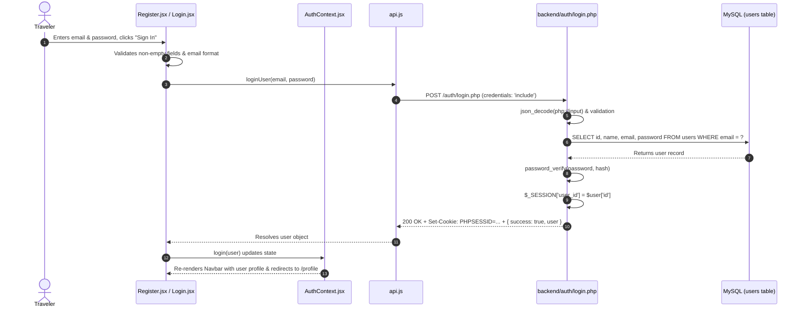
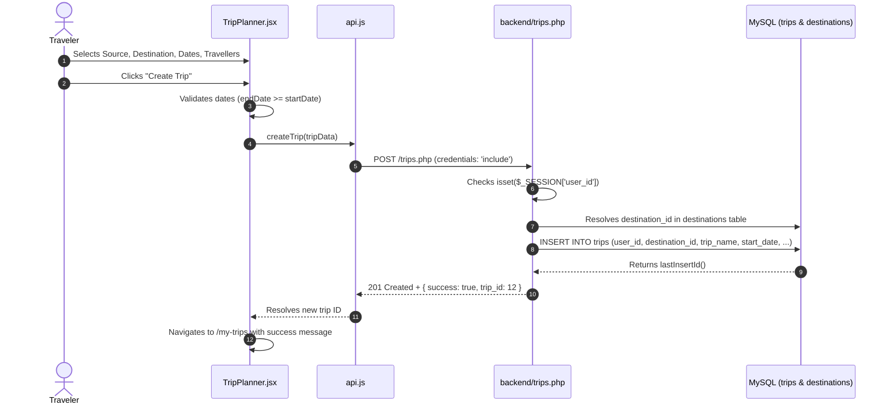
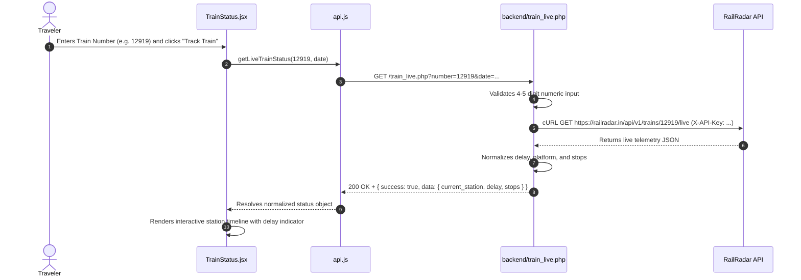
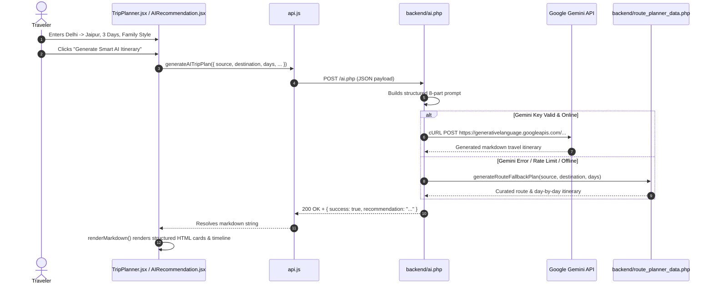

# Travel Journey Planner — Feature Flow & Function Guide

> **Target Audience:** Engineering Viva Candidate & Demonstration Guide.  
> **Purpose:** Detailed function-by-function documentation (Stage 4) and step-by-step feature execution traces (Stage 5) with sequence diagrams.

---

# PART 1: CORE FUNCTION EXPLANATIONS

### Function: `checkAuth()`
- **File:** `frontend/src/services/api.js`
- **Purpose:** Checks if the client has an active, authenticated PHP session on application startup or page refresh.
- **Called by:** `useEffect` hook in `frontend/src/context/AuthContext.jsx`.
- **Inputs:** None.
- **Output:** Resolves to `{ loggedIn: true, user: { id, name, email } }` or `{ loggedIn: false, user: null }`.
- **Important variables:** `response`, `result`, `credentials: 'include'`.
- **Step-by-step execution:**
  1. Sends an HTTP `GET` request to `${API_URL}/auth/check.php`.
  2. Passes browser cookies using `credentials: 'include'`.
  3. Parses the returned JSON response.
  4. Returns the user object if authenticated, or falls back to `loggedIn: false`.
- **API/database interaction:** Calls `/auth/check.php` which inspects `$_SESSION['user_id']`.
- **Error handling:** If a network error occurs or backend is unreachable, catches the exception and safely resolves to `{ loggedIn: false, user: null }` without crashing the app.
- **Why this function matters:** It preserves user login state across browser page refreshes without needing insecure `localStorage` tokens.
- **A simple explanation I can say during my viva:** *"When our React app loads, `checkAuth` asks the PHP backend if there is an active session cookie. If yes, it logs the user straight in; if not, it keeps them as a guest."*

---

### Function: `loginUser(email, password)`
- **File:** `frontend/src/services/api.js`
- **Purpose:** Submits user credentials to the PHP backend to authenticate and initiate a session.
- **Called by:** `handleSubmit` inside `frontend/src/pages/Login.jsx`.
- **Inputs:** `email` (string), `password` (string).
- **Output:** Returns `{ success: true, user: { id, name, email }, message: "..." }` or throws an error.
- **Important variables:** `body: JSON.stringify({ email, password })`, `credentials: 'include'`.
- **Step-by-step execution:**
  1. Dispatches an HTTP `POST` request to `${API_URL}/auth/login.php`.
  2. Sends email and password in the JSON body.
  3. Checks `response.ok`. If not ok, extracts error message and throws an Error.
  4. On HTTP 200, updates `AuthContext` with the user profile.
- **API/database interaction:** Calls `backend/auth/login.php`, which queries MySQL table `users` with `SELECT id, name, email, password FROM users WHERE email = ?` and validates via `password_verify()`.
- **Error handling:** Catches invalid credentials or network downtime; sets friendly error string to `error` state in `Login.jsx`.
- **Why this function matters:** It securely logs the user into the system and establishes a persistent PHP session.
- **A simple explanation I can say during my viva:** *"This function sends the user's email and password to the PHP login endpoint, verifies the bcrypt hash in MySQL, and sets an HTTP session cookie."*

---

### Function: `createTrip(tripData)`
- **File:** `frontend/src/services/api.js`
- **Purpose:** Persists a newly created trip into the database for the currently authenticated user.
- **Called by:** `handleSubmit` in `frontend/src/pages/TripPlanner.jsx`.
- **Inputs:** `tripData` object containing `destination_id`, `destination_name`, `source_location`, `start_date`, `end_date`, `num_travellers`, `notes`.
- **Output:** Resolves to `{ success: true, trip_id: number, message: string }`.
- **Important variables:** `body: JSON.stringify(tripData)`, `credentials: 'include'`.
- **Step-by-step execution:**
  1. Issues an HTTP `POST` to `${API_URL}/trips.php`.
  2. PHP verifies `$_SESSION['user_id']`. If missing, returns HTTP 401 Unauthorized.
  3. PHP validates dates, destination, and traveller count.
  4. PHP inserts record into MySQL `trips` table using parameterized PDO statement.
  5. Returns the generated `trip_id` (`$conn->lastInsertId()`).
- **API/database interaction:** Executes `INSERT INTO trips (user_id, destination_id, trip_name, source_location, start_date, end_date, num_travellers, notes) VALUES (?, ?, ?, ?, ?, ?, ?, ?)`.
- **Error handling:** Throws on validation failure or HTTP 500 error; caught by `TripPlanner.jsx` to display a user-friendly error toast.
- **Why this function matters:** It connects user interface form state directly to persistent database storage.
- **A simple explanation I can say during my viva:** *"When the user submits the trip planner form, `createTrip` sends the travel details to `trips.php`, which verifies their session and saves the new trip into MySQL."*

---

### Function: `getTrips()`
- **File:** `frontend/src/services/api.js`
- **Purpose:** Fetches all saved trips belonging strictly to the currently logged-in user.
- **Called by:** `loadTrips()` inside `frontend/src/pages/MyTrips.jsx`.
- **Inputs:** None.
- **Output:** Returns an array of trip objects.
- **Important variables:** `response`, `result.data`, `credentials: 'include'`.
- **Step-by-step execution:**
  1. Issues an HTTP `GET` to `${API_URL}/trips.php`.
  2. Backend looks up `$_SESSION['user_id']` and queries the database.
  3. Joins with the `destinations` table to retrieve destination names.
  4. Returns the sorted list of trips.
- **API/database interaction:** `SELECT t.*, d.name AS destination_name FROM trips t LEFT JOIN destinations d ON t.destination_id = d.id WHERE t.user_id = ? ORDER BY t.start_date ASC`.
- **Error handling:** If unauthorized or offline, falls back to local storage mock data to prevent crashes during demonstrations.
- **Why this function matters:** It populates the user's personal travel dashboard (`/my-trips`).
- **A simple explanation I can say during my viva:** *"This function retrieves all trips associated with the logged-in user's ID from MySQL and presents them on the My Trips page."*

---

### Function: `searchTrains(from, to, date)`
- **File:** `frontend/src/services/api.js`
- **Purpose:** Queries available trains running between two railway stations on a given date.
- **Called by:** `handleSearch` inside `frontend/src/pages/TrainSearch.jsx`.
- **Inputs:** `from` (station code, e.g., 'NDLS'), `to` (station code, e.g., 'CSMT'), `date` (YYYY-MM-DD).
- **Output:** Returns an array of normalized train objects with train number, name, departure/arrival times, duration, and classes.
- **Important variables:** `query params: ?from=...&to=...&date=...`.
- **Step-by-step execution:**
  1. Formats station codes to uppercase.
  2. Sends an HTTP `GET` request to `${API_URL}/trains.php?from=${from}&to=${to}&date=${date}`.
  3. `backend/trains.php` queries the RailRadar API using server-side cURL.
  4. Response is normalized and returned to React.
- **API/database interaction:** Proxied through `backend/trains.php` to RailRadar endpoint `https://railradar.in/api/v1/trains/between`.
- **Error handling:** Returns error string if stations are invalid; displays friendly warning in `TrainSearch.jsx`.
- **Why this function matters:** Enables travelers to seamlessly find transit options directly inside the trip planner.
- **A simple explanation I can say during my viva:** *"This function sends source and destination station codes to our PHP proxy, which securely queries the RailRadar API and returns all matching trains."*

---

### Function: `getLiveTrainStatus(trainNumber, date)`
- **File:** `frontend/src/services/api.js`
- **Purpose:** Fetches the real-time live running status of any Indian Railways train.
- **Called by:** `fetchLiveStatus()` inside `frontend/src/pages/TrainStatus.jsx`.
- **Inputs:** `trainNumber` (5-digit string, e.g., '12919'), `date` (YYYY-MM-DD optional).
- **Output:** Returns live status object (current station, delay in minutes, platform, upcoming stops).
- **Important variables:** `cleanNumber = preg_replace('/[^0-9]/', '', $rawNumber)`.
- **Step-by-step execution:**
  1. Validates that the train number is 4–5 digits.
  2. Sends HTTP `GET` to `${API_URL}/train_live.php?number=${trainNumber}&date=${date}`.
  3. PHP calls RailRadar Live endpoint using cURL and internal API key.
  4. Returns real-time delay telemetry and station timeline to the UI.
- **API/database interaction:** Proxied through `backend/train_live.php` to RailRadar live running status service.
- **Error handling:** Returns 400 for malformed numbers; displays clear feedback if the train is not currently running.
- **Why this function matters:** Provides high-value utility for active travelers tracking their journey en route.
- **A simple explanation I can say during my viva:** *"It takes a train number, validates it, and fetches real-time telemetry from RailRadar including current delay, platform number, and upcoming stations."*

---

### Function: `generateAITripPlan(planParams)`
- **File:** `frontend/src/services/api.js`
- **Purpose:** Generates a comprehensive day-by-day travel plan using Google Gemini AI or an intelligent offline fallback engine.
- **Called by:** `handleGenerateAI()` in `frontend/src/pages/TripPlanner.jsx` and `frontend/src/pages/AIRecommendation.jsx`.
- **Inputs:** `{ source, destination, days, travellers, budget, preferences }`.
- **Output:** Returns markdown/structured itinerary string.
- **Important variables:** `body: JSON.stringify(planParams)`.
- **Step-by-step execution:**
  1. Sends HTTP `POST` to `${API_URL}/ai.php`.
  2. PHP prepares an engineered prompt enforcing 8 distinct sections (route, day-wise schedule, food, sights, budget).
  3. Sends request to Gemini 1.5/2.0 API.
  4. If Gemini is unreachable or rate-limited, PHP automatically invokes `route_planner_data.php` to generate a route-specific plan.
  5. Returns markdown text to React, where `renderMarkdown()` transforms it to HTML.
- **API/database interaction:** Calls Google Generative Language API via cURL in `backend/ai.php`.
- **Error handling:** Fail-safe dual fallback: if external API fails, local heuristic engine supplies complete itinerary.
- **Why this function matters:** It is the marquee smart feature that gives travelers instant personalized trip plans.
- **A simple explanation I can say during my viva:** *"This function sends the travel details to our PHP AI service, which queries Google Gemini to create a customized day-by-day itinerary with an automatic offline fallback if internet drops."*

---

# PART 2: FEATURE-WISE EXECUTION TRACES

---

## Feature 1: User Registration & Authentication

### Detailed Trace:
1. **User Action:** Traveler navigates to `/login`, fills in credentials, and clicks "Sign In".
2. **Frontend File:** `frontend/src/pages/Login.jsx`.
3. **Handler Function:** `handleSubmit(e)`.
4. **State Variables Changed:** `setLoading(true)`, `setError('')`.
5. **Service Invoked:** `loginUser(email, password)` in `frontend/src/services/api.js`.
6. **Request Sent:** HTTP `POST` to `http://localhost/travel-journey-planner/backend/auth/login.php` with `{ "email": "...", "password": "..." }` and `credentials: 'include'`.
7. **Backend Endpoint:** `backend/auth/login.php`.
8. **Validation & Processing:**
   - Validates that email and password are provided.
   - Validates email format with `FILTER_VALIDATE_EMAIL`.
   - Executes prepared query against MySQL: `SELECT id, name, email, password FROM users WHERE email = ?`.
   - Verifies password using `password_verify($password, $user['password'])`.
9. **Database Operation:** Read from `users` table.
10. **Session Initialization:** On match, stores `$_SESSION['user_id'] = $user['id']` and emits cookie `PHPSESSID`.
11. **Response Returned:** `{ "success": true, "message": "Login successful", "user": { "id": 1, "name": "...", "email": "..." } }`.
12. **Frontend Response Handling:** `login(result.user)` is called on `AuthContext`, setting `user` state globally.
13. **Final UI View:** App navigates to `/profile`, Navbar displays the user's name and avatar badge.

---

## Feature 2: Trip Planning & Persistence (CRUD)

### Detailed Trace:
1. **User Action:** User fills out the Trip Planner form at `/plan-trip` and clicks "Save Trip".
2. **Frontend File:** `frontend/src/pages/TripPlanner.jsx`.
3. **Handler Function:** `handleSubmit(e)`.
4. **State Variables Changed:** `setSubmitting(true)`, `setError('')`.
5. **Service Invoked:** `createTrip(tripData)` in `frontend/src/services/api.js`.
6. **Request Sent:** HTTP `POST` to `backend/trips.php` with `{ destination_id, destination_name, source_location, start_date, end_date, num_travellers, notes }`.
7. **Backend Endpoint:** `backend/trips.php`.
8. **Validation & Processing:**
   - Checks `isset($_SESSION['user_id'])`. If not set, returns HTTP 401.
   - Verifies `startDate <= endDate` and `num_travellers >= 1`.
   - Looks up or auto-creates custom destination record to maintain foreign key integrity.
9. **Database Operation:** Executes `INSERT INTO trips (...) VALUES (...)`.
10. **Response Returned:** HTTP 201 Created with `{ "success": true, "trip_id": 42 }`.
11. **Frontend Response Handling:** Clears form state, invokes `navigate('/my-trips')`.
12. **Final UI View:** User is taken to `/my-trips` where their newly planned trip appears at the top of the timeline.

---

## Feature 3: Live Train Status Tracking (RailRadar API)

### Detailed Trace:
1. **User Action:** Traveler inputs a 5-digit Indian Railway train number (e.g., `12919` - Malwa Express) into the search bar at `/train-status` and clicks "Track Live Status".
2. **Frontend File:** `frontend/src/pages/TrainStatus.jsx`.
3. **Handler Function:** `fetchLiveStatus(number, date)`.
4. **State Variables Changed:** `setLoading(true)`, `setError('')`, `setLiveStatus(null)`.
5. **Service Invoked:** `getLiveTrainStatus(trainNumber, date)` in `frontend/src/services/api.js`.
6. **Request Sent:** HTTP `GET` to `backend/train_live.php?number=12919&date=2026-10-14`.
7. **Backend Endpoint:** `backend/train_live.php`.
8. **Validation & Processing:**
   - Sanitizes input: `preg_replace('/[^0-9]/', '', $rawNumber)`.
   - Ensures string length is between 4 and 5 characters.
   - Reads `RAILRADAR_API_KEY` securely from server configuration.
9. **External Service Call:** Executes server-side cURL request to `https://railradar.in/api/v1/trains/12919/live`.
10. **Response Returned:** Normalizes raw API response into `{ success: true, data: { train_name, current_station, delay_minutes, platform, stations: [...] } }`.
11. **Frontend Response Handling:** `setLiveStatus(data)` updates React state.
12. **Final UI View:** An animated train progress bar appears showing past stations in green, the current station with live delay in orange/red, and upcoming stops with expected arrival times.

---

## Feature 4: AI Itinerary Generation (Gemini API & Route Fallback)

### Detailed Trace:
1. **User Action:** Traveler selects departure city (e.g., Delhi) and destination (e.g., Jaipur), sets duration to 3 days, and clicks "Generate Smart AI Itinerary".
2. **Frontend File:** `frontend/src/pages/TripPlanner.jsx` or `AIRecommendation.jsx`.
3. **Handler Function:** `handleGenerateAI()`.
4. **State Variables Changed:** `setGeneratingAI(true)`, `setAiError('')`.
5. **Service Invoked:** `generateAITripPlan(params)` in `frontend/src/services/api.js`.
6. **Request Sent:** HTTP `POST` to `backend/ai.php` with `{ source: "Delhi", destination: "Jaipur", days: 3, travellers: 2, budget: 15000 }`.
7. **Backend Endpoint:** `backend/ai.php`.
8. **Validation & Processing:**
   - Validates destination is not empty and days is between 1 and 30.
   - Constructs an engineered prompt requesting 8 specific sections.
9. **External API Execution:** Sends HTTPS POST via cURL to Google Gemini endpoint.
   - If the request succeeds: returns the AI generated markdown.
   - If Google returns an error or quota exceeded: catches the issue and calls `backend/route_planner_data.php` to construct an authentic, route-tailored itinerary.
10. **Response Returned:** `{ "success": true, "recommendation": "### 1. Journey Overview...", "source": "gemini" | "route_specific_planner" }`.
11. **Frontend Response Handling:** Markdown is converted to safe HTML via `renderMarkdown()` without external dependencies.
12. **Final UI View:** An interactive accordion and visual itinerary card display daily morning, afternoon, and evening schedules, local food recommendations, and budget tips.

---

## Feature 5: Client-Side Trip Budget Calculator

### Detailed Trace:
1. **User Action:** Traveler visits `/budget` (or clicks "Calculate Budget" from a saved trip).
2. **Frontend File:** `frontend/src/pages/BudgetCalculator.jsx`.
3. **Implementation Type:** **100% Client-Side Pure React State** (No API or DB required).
4. **State Variables:**
   - `budget`: Object containing amounts for `{ travel, hotel, food, activities, other }`.
   - `targetBudget`: User's total planned spending cap.
   - `travellers`: Number of people sharing costs.
5. **Mathematical Calculations:**
   - `totalExpenses = travel + hotel + food + activities + other`
   - `perPersonCost = totalExpenses / travellers`
   - `remainingBudget = targetBudget - totalExpenses`
   - `percentage = (totalExpenses / targetBudget) * 100`
6. **UI Rendering:**
   - Visual progress bar color-coded based on spending:
     - `< 80%`: Green (Healthy budget)
     - `80% - 100%`: Orange (Approaching limit)
     - `> 100%`: Red (Budget exceeded alert)
   - Dynamic pie-chart style categorical breakdown.
